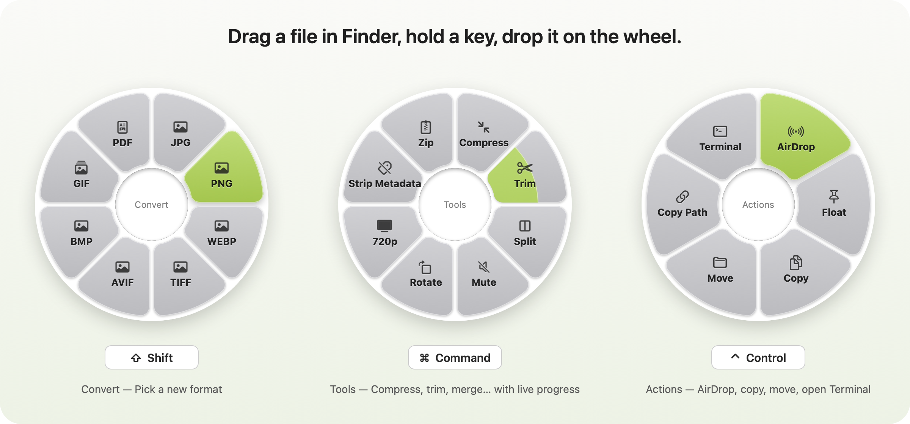

# Lime

Lime converts and edits files right from Finder. Drag a file, hold a key, and drop it on the wheel that appears under the pointer. The button fills as the job runs; the result is saved next to the original, which is never changed.

| Hold | Wheel | For |
|---|---|---|
| Shift | Convert | Images, audio, video, PDF, documents, spreadsheets, subtitles, archives |
| Command | Tools | Compress, resize, trim, split, merge, rotate, extract, … |
| Control | Actions | AirDrop, Float, Copy, Move, Copy Path, Terminal |

Or select files in Finder and press **Option-Return**, then use the arrow keys, Return and Escape.
Keys, appearance and glassiness are under **Settings…** in the menu bar.

**Private by design:** everything runs on your Mac. No files are uploaded, and Lime collects no data.

## Install

Download `Lime.zip` from [Releases](https://github.com/FabianRiegsinger/lime/releases), unzip it and move Lime to Applications.
Requires a Mac with Apple silicon and macOS 13 or later; the glass look needs macOS 26.

## Support

Report problems at [Issues](https://github.com/FabianRiegsinger/lime/issues).

## License

Apache-2.0. Lime bundles FFmpeg under the LGPL; all third-party notices are under **Acknowledgements…** in the menu bar. Building from source: [docs/DEVELOPMENT.md](docs/DEVELOPMENT.md).
